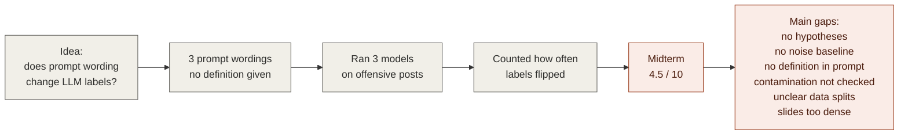
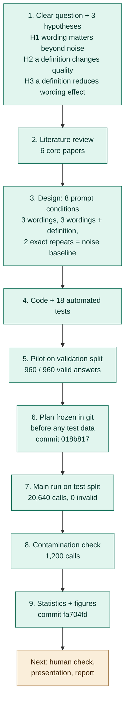
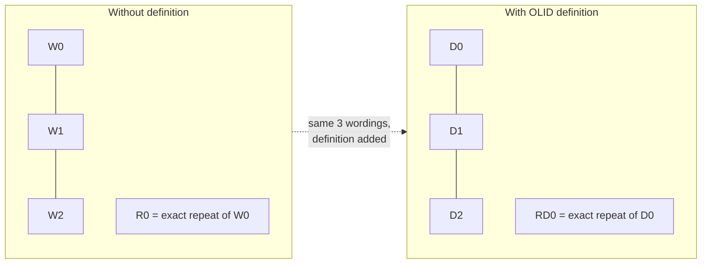
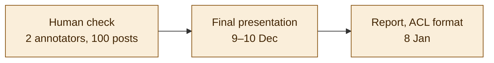

# Project map: before and after the midterm

**Research question:** if we change only the *wording* of a prompt, or add a *definition* of "offensive", do LLMs label the same social-media posts differently?

**Data:** TweetEval / OLID offensive-language test set (860 posts, human labels).
**Models:** Gemma 4 26B, Qwen 3.6 36B, Llama 3.3 70B (via the maKI API, temperature 0).

---

## 1. Before the midterm (old version, replaced)

---

## 2. After the midterm (rebuilt from scratch, using the feedback)

### The 8 prompt conditions in one picture

The repeats tell us how much a model changes its answer **by chance**. A wording effect only counts if it is bigger than that.

---

## 3. How each feedback point was fixed

| Midterm feedback | What we do now |
|---|---|
| No hypotheses | H1–H3 written down and tested with fixed statistical tests |
| No baseline / noise floor | Exact-repeat conditions (R0, RD0), plus majority and random baselines |
| No definition in the prompt | Definition conditions D0–D2 using the official OLID definition |
| Contamination not addressed | Memorisation probe (Golchin & Surdeanu 2024 method) |
| Unclear data splits | Pilot on the validation split only; final results on the test split only; dataset version pinned |
| Unclear analysis | Analysis plan frozen in git before the test data was collected |
| Presentation too dense | New talk: about 10 slides, one message per slide |

---

## 4. Results in plain words

| Finding | Number |
|---|---|
| Changing only the first sentence of the prompt flips labels on a small share of posts | about 2.5–3% per pair of wordings (repeats: about 0%) |
| Adding the definition helps 2 of 3 models | macro-F1 +0.09 (Gemma), +0.05 (Qwen), no change (Llama) |
| The definition pulls every model toward the human labelling standard | share labelled offensive moves toward the true 28% for all 3 models |
| The choice of model matters more than the wording | Gemma and Llama disagree on about 21% of posts |
| Contamination check | no signal for Gemma or Qwen; weak signal for Llama, no copied posts |

All 6 main tests ran as planned; the results are unchanged when duplicate posts are removed.

---

## 5. What is left

## 6. Questions we would like guidance on

1. Is a plan frozen in a git commit before data collection acceptable as our preregistration?
2. Is the human check (50 posts where labels flipped vs 50 where they did not, 2 annotators) enough?
3. Should the talk lead with the "model choice matters most" result or with the wording result?
4. How should we report the weak contamination signal for Llama?
5. Is an extra analysis using the models' confidence scores (log probabilities) worth adding, or should we keep the scope?
