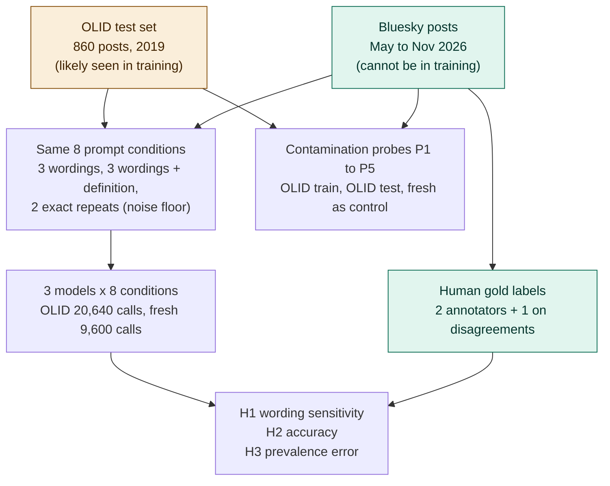
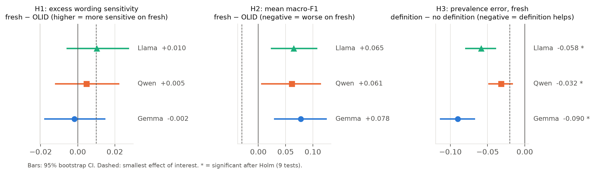
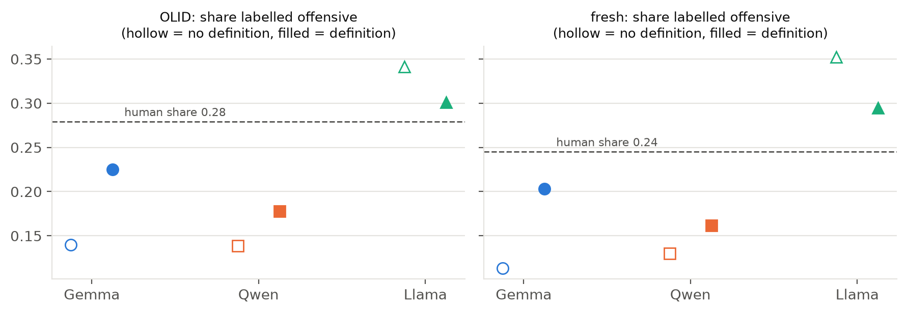

# PromptShift: project map (v3, after the 19 November feedback)

**Research question:** do prompt wording and a codebook definition affect LLM annotation of offensive language differently on data the models have likely seen in training (OLID, 2019) than on posts written **after** the models were released, and what does that mean for prevalence estimates?

**Models:** Gemma 4 26B, Qwen 3.6 36B, Llama 3.3 70B via the maKI API, temperature 0.
**Data:** OLID / TweetEval test split (860 posts, 2019) and 400 new Bluesky posts (May to November 2026).

Earlier versions: `main` branch = midterm (v1); commits before `e7610de` on this branch = v2 (OLID only).

---

## 1. What the feedback asked for and what we did

| Feedback (19 Nov) | What we did |
|---|---|
| Hypotheses not sharp enough | 3 hypotheses with a fixed estimand, direction, test and smallest effect of interest, frozen in git before any model saw the new data ([PLAN_v3.md](PLAN_v3.md), commit `e7610de`) |
| Not clear how this differs from previous work | Literature check: the definition effect (Atreja et al. 2025) and before/after-cutoff comparisons (Li & Flanigan 2024) are known. **New here:** the same prompt design on guaranteed-unseen data, the effect on prevalence estimates, and contamination probes checked against a negative control |
| OLID is old and probably in the training data | New dataset of posts written after all three models were released, labelled by the team; five contamination probes, each also run on the unseen posts as a control |

---

## 2. The design

**Order of work (each step committed to git):**
collect posts → freeze plan (`e7610de`) → run models on new posts and commit the answers (`3e909d6`) → **then** human labels (`c544494`) → analysis (`4b4eb0a`). The labels were made without seeing any model answer on these posts.

---

## 3. The new data

| Step | Count |
|---|---|
| Bluesky posts returned (8 OLID keywords, 7 months) | 15,561 |
| Kept after filters (English, no reposts or quote posts, keyword in text, created after 1 May 2026) | 11,405 |
| After removing duplicates | 10,926 |
| Sampled (balanced by keyword and month, at most 2 per author) | 470 = 400 main + 40 pilot + 30 calibration |

**Human labels (400 posts):** two annotators, Krippendorff's alpha **0.776** (91.2% agreement), 35 disagreements decided by a third annotator, **24.5% offensive**.
Agreement with OLID's own labels on 100 OLID posts mixed in: kappa **0.43 and 0.37**. Privacy: no author identities stored, no post text published.

---

## 4. Results

### Confirmatory tests (9 tests, Holm-corrected)

| | Gemma | Qwen | Llama | Verdict |
|---|---|---|---|---|
| **H1** wording sensitivity: fresh − OLID | −0.002 | +0.005 | +0.010 | **Not supported**: about the same on unseen posts |
| **H2** macro-F1: fresh − OLID | +0.078 | +0.061 | +0.065 | **Not interpretable** (pre-set rule: kappa with OLID labels below 0.60) |
| **H3** definition reduces prevalence error on fresh posts | −0.090 * | −0.032 * | −0.059 * | **Supported for all three models** |

\* significant after Holm correction. Full tables: [summary_v3.md](artifacts/results_v3/summary_v3.md)

### What it means

1. **Prompt sensitivity is not caused by memorised data.** On unseen posts, changing one sentence still changes 2.7–3.5% of labels per pair of wordings (OLID: 2.5–3.0%); exact repeats change 0–0.75%.
2. **The codebook definition works on unseen data, in both directions.** Share labelled offensive vs the human 24.5%: Gemma 11% → 20%, Qwen 13% → 16%, Llama 35% → 29%.
3. **Model choice matters most.** On the same prompt, Llama disagrees with Gemma on 24.5% and with Qwen on 23.0% of fresh posts.
4. **Exploratory:** posts whose label flips with the wording are ones the model was less sure about (Qwen: about 27 percentage points lower confidence, on both datasets).

### Contamination checks (with the fresh posts as a negative control)

| Probe | OLID | Fresh (cannot be memorised) | Reading |
|---|---|---|---|
| P2 near-verbatim completions | 6 found: famous quotes and common phrases | — | No OLID post reproduced |
| P3 label recall when told "this is OLID" | no gain | no gain | No sign the labels were memorised |
| P1 completion with dataset name | Llama +0.02 | Llama +0.02 | Same on unseen posts, so it is a prompt effect, not memory |
| P5 pick the original among paraphrases | 44–67% | 53–70% | Same or higher on unseen posts: models spot paraphrases, not memorised posts |
| P4 Min-K% (Qwen, Llama) | OLID not more familiar | — | Suggestive only (time-shift confound) |

**Verdict:** no probe found OLID more familiar than posts the models cannot have seen. Two signals that would have looked like contamination (P1 for Llama, P5 for all) appear equally on the unseen posts, which is why the negative control matters. This does not prove OLID is absent from training data; it shows our main findings hold on data where contamination is impossible.

---

## 5. Limitations (stated up front)

- One task, one platform per dataset; Bluesky users differ from 2019 Twitter users.
- Three minimal wordings, so the wording effect is likely a lower bound.
- Our labels and OLID's differ (kappa about 0.4), so accuracy cannot be compared across datasets (H2).
- With annotator A's labels alone, H3 stays significant for Gemma and Qwen but not for Llama (sensitivity table in summary_v3.md).
- No contamination probe detects OLID, so "OLID was seen in training" remains an assumption.
- Precision (95% CI half-widths): H1 about ±0.017, H3 about ±0.02; small differences in wording sensitivity (below about 0.02) cannot be ruled out.

## 6. Where everything is

| What | Link |
|---|---|
| 8-page visual overview (before/after, data, timeline, real example) | [docs/PromptShift_v3_Simple.pdf](docs/PromptShift_v3_Simple.pdf) |
| References (checked) | [docs/references.md](docs/references.md) |
| Frozen plan, hypotheses, deviation log | [PLAN_v3.md](PLAN_v3.md) |
| Results v3 (tables, figures) | [artifacts/results_v3](artifacts/results_v3) |
| Contamination battery | [artifacts/contam/contam_summary.md](artifacts/contam/contam_summary.md) |
| Collection, labelling, analysis code | [src/promptshift](src/promptshift) (`collect_fresh.py`, `annotate_fresh.py`, `analyze_v3.py`, `contam.py`) |
| Frozen fingerprints (hashes, counts) | [protocol](protocol) |
| How to reproduce | [README.md](README.md) |

## 7. Questions for guidance

1. Is the kappa rule for H2 (pre-set at 0.60) the right call, or should H2 be reported only descriptively?
2. Should the talk lead with the definition result (H3) or with the contamination control?
3. Is the negative-control approach to contamination enough, given that training data cannot be inspected?
