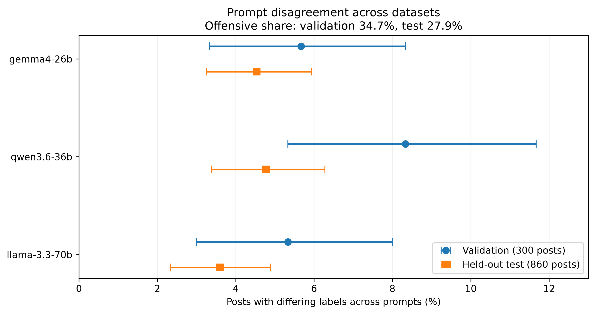
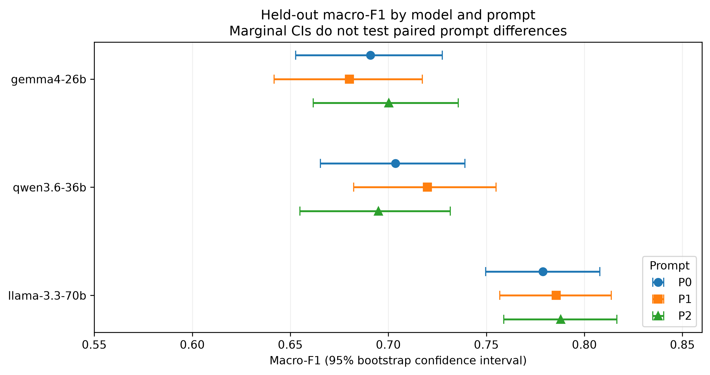
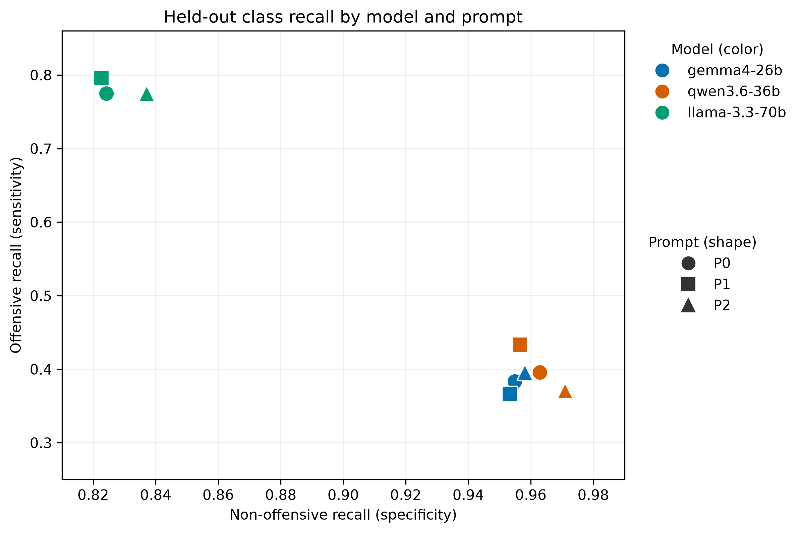

# LLM PromptShift

**Prompt sensitivity and classification stability in zero-shot offensive-language detection**

Small changes to an instruction can change an LLM's label for the same post. This project measures that behavior across three prompt variants (P0, P1, P2) and three hosted model aliases on TweetEval `offensive`. It provides archived predictions and a reproducible analysis; reproduction does not call the models.

## Research overview

The study uses 12 pilot posts, 300 development posts from the official validation split, and 860 held-out test posts. Each model classified the same posts under each prompt variant. The archive contains **10,620 prediction records**: 108 pilot, 2,700 development, 7,740 held-out, and 72 repeatability records.

| Hosted maKI API alias | Held-out posts with a differing label across prompts | P0 macro-F1 | P1 macro-F1 | P2 macro-F1 |
| --- | ---: | ---: | ---: | ---: |
| `gemma4-26b` | 39 / 860 (4.53%) | 0.6908 | 0.6801 | 0.7002 |
| `qwen3.6-36b` | 41 / 860 (4.77%) | 0.7037 | 0.7199 | 0.6949 |
| `llama-3.3-70b` | 31 / 860 (3.60%) | 0.7789 | 0.7856 | 0.7880 |

These are descriptive results. **All nine Bonferroni-adjusted confidence intervals include zero**: six within-model P1/P2 versus P0 macro-F1 comparisons and three between-model disagreement-rate comparisons. The correction was applied post hoc. The results do not establish that one prompt or model is statistically superior. See the [complete results and intervals](docs/verified_results_v2.md).

## Research figures



*Figure 1. Share of posts with at least one differing prediction across prompts, with validation and held-out context.* [PDF](figures/figure1_prompt_sensitivity.pdf)



*Figure 2. Held-out macro-F1 and marginal confidence intervals. Paired prompt differences are assessed separately in the comparison table.* [PDF](figures/figure2_macro_f1.pdf)



*Figure 3. Offensive and non-offensive recall across the nine held-out conditions.* [PDF](figures/figure3_recall_tradeoff_v2.pdf)

## Methodology

- **Dataset:** CardiffNLP [TweetEval `offensive`](https://huggingface.co/datasets/cardiffnlp/tweet_eval), pinned to revision `b3a375baf0f409c77e6bc7aa35102b7b3534f8be`. The held-out set has 620 non-offensive and 240 offensive posts. Raw tweet text is downloaded during reproduction and is not tracked here.
- **Prompts:** Three closely related zero-shot instructions in [prompts.py](src/promptshift/prompts.py), each requesting `OFFENSIVE` or `NOT_OFFENSIVE`. Semantic equivalence was not independently established.
- **Inference:** maKI API aliases `gemma4-26b`, `qwen3.6-36b`, and `llama-3.3-70b`, temperature 0 and `max_tokens=16`. The aliases do not identify immutable checkpoints; see [model provenance](reproducibility/model_provenance.md).
- **Analysis:** Post-level disagreement across P0/P1/P2, accuracy, macro-F1, class recall, and 5,000 stratified paired bootstrap resamples for comparisons. The reference prompt is P0. An exact-text duplicate sensitivity analysis retains 840 singleton posts.
- **Historical reconstruction:** [Sample IDs](reproducibility/sample_manifest_v1.json) and [test-text suffixes](reproducibility/test_text_suffix_manifest.json) preserve archived inputs. The original development sampling seed is unknown; the recorded test suffixes must be retained to reproduce archived requests.

## Reproduce the archived analysis

Use Python 3.12 (the reference environment used 3.12.3) on Ubuntu or WSL. From the repository root:

```bash
python3.12 -m venv .venv
source .venv/bin/activate
python -m pip install -r reproducibility/requirements-lock.txt
python -m pip check
python reproducibility/test_public_analysis.py
```

The first run downloads pinned public dataset files and checks their fingerprints. The script reconstructs input tables, analyzes the archived predictions, and exports **17 CSV tables** and **6 figure files** to ignored `reproduced_outputs/`. It prints `PUBLIC_DATA_BOOTSTRAP_OK`, `PUBLIC_ANALYSIS_REPRODUCTION_OK`, and `REPRODUCED_OUTPUTS_EXPORTED_OK` on success. No API key or new inference is needed.

## Project structure

```text
src/promptshift/          Prompt templates, preparation, inference, analysis, and plotting scripts
reproducibility/          Bootstrap and reproduction test, dependency lock, manifests, provenance
artifacts/predictions/    Four archived JSONL prediction files
figures/                  Three final research figures as PNG and PDF
docs/                     Verified numerical results and qualitative provenance
reproduced_outputs/       Local regenerated tables and figures (ignored by Git)
```

The scripts use the repository root for their `data/` inputs and outputs. The public reproduction test builds an isolated temporary workspace with the same layout. The `run_*.py` scripts are historical live-inference entry points; they require authorized maKI access and are not invoked by the reproduction test.

## Limitations and attribution

The study covers one English social-media dataset, three nearby prompt formulations, and one hosted inference environment. Exact model checkpoints and serving settings are unverified; temperature 0 does not guarantee repeatability. The test set includes exact-text duplicates and a conflicting gold-label duplicate. Possible pretraining exposure to TweetEval cannot be excluded. The post-hoc multiplicity correction and intervals support cautious interpretation, not equivalence or superiority claims. See [qualitative-case provenance](docs/qualitative_case_provenance.md).

Dataset: CardiffNLP TweetEval `offensive`. Tweet content and model access have separate rights and are not bundled. The project originated in the University of Mannheim IS6170 course, *Large Language Models for the Economic and Social Sciences* (HWS 2026). Contributor credit and a code license require team confirmation before publication.
